# s2s — Site-to-Source

[](https://github.com/Rosdal/s2s/actions/workflows/ci.yml)

[](LICENSE)

s2s turns a live URL into a plausible, buildable reconstruction of its frontend source. The CLI does the deterministic work: it captures the page in a real browser, recovers source maps, detects third-party packages, unbundles and cleans up the first-party code, and scaffolds a project. Then it writes `AGENTS.md` and `PROMPT.md`, so the reasoning-heavy part (naming, structure, types) runs in Claude Code on your own subscription, with a screenshot-diff verify loop to check the result.

> **Status: alpha.** Every stage runs end to end on the test fixtures. Expect rough edges on real sites.

## Usage

s2s needs Node 22 or later, Google Chrome (or Playwright's Chromium: `npx playwright install chromium`), git, and a package manager (pnpm, npm, yarn or bun).

```sh
npx @rosdal/s2s grab https://example.com
```

`grab` captures the site, recovers what it can, writes a Vite project that builds as is, and checks that project against the capture. It ends by printing the next step:

```sh
cd example-com && claude "$(cat PROMPT.md)"
```



The recording is a real run against a local test fixture (`.github/assets/demo.cast`; replay it with `asciinema play`).

Run `s2s` with no arguments for a guided prompt instead. Each stage is also its own command, and every stage resumes from the workspace's `manifest.json`, so rerunning `grab` after an interruption continues where it stopped:

| Command             | Stage                                                                |
| ------------------- | -------------------------------------------------------------------- |
| `s2s capture <url>` | Record every request, page snapshot and screenshot in a real browser |
| `s2s maps`          | Recover original sources from source maps                            |
| `s2s detect`        | Identify npm packages and write `project/package.json`               |
| `s2s unbundle`      | Split first-party code into readable modules and agent work groups   |
| `s2s scaffold`      | Write the Vite project, the agent files and a git repo               |
| `s2s verify`        | Build the project and compare it with the capture                    |

## Reconstructing with Claude Code

The CLI does the deterministic work. Naming, structure and types are left to a coding agent, run on your own subscription. The workspace holds what the agent needs:

- `AGENTS.md` (imported by `CLAUDE.md`): the rules, the detected stack and packages, each fact pointing at the `analysis/` file it came from.
- `PROMPT.md`, also available as the `/s2s` slash command: the task. It is resumable, so a new session with the same prompt continues from the first unticked item.
- `PROGRESS.md`: one checklist item per work group, plus packages to review.
- `.claude/settings.json`: pre-approves `s2s verify`, the project's build and typecheck, and git. Nothing else.

The agent moves code out of `project/src/_recovered/` one group at a time, runs `s2s verify` after each, and commits when it passes. Verify serves the build with the captured responses replayed, never contacts the real site, and fails on:

- more than 2% of pixels changed per page and viewport (regions that changed on their own during capture, such as clocks and carousels, are masked),
- DOM similarity to the captured page below 0.95,
- console errors the capture did not have, or
- failed requests.

Exit codes are 0 for pass, 1 for a regression (details in `verify/report.md`), 2 for a failed build and 3 when verify itself could not run. Thresholds live in the workspace's `s2s.config.ts`.

## Limits

- Next.js, Nuxt, Astro and SvelteKit sites become a Vite single-page app built from the hydrated DOM, not a project in their framework.
- Only what a visitor's browser receives can be recovered: no server code, comments, tests or history.
- Without source maps, names and module boundaries are guesses. The agent improves them; it cannot know the originals.
- Pages behind interactions the capture didn't trigger are missing, and verify blocks any request the capture has no response for.

## Intended use

s2s is an analysis and learning tool. Use it to:

- learn how a site's frontend is built,
- analyse code that already runs in your browser, and
- recover frontend source that you own but lost.

Do not use it to:

- **redistribute or reuse someone else's code.** Reconstructed first-party code still belongs to the site owner.
- **ignore a site's terms.** Many sites forbid scraping. s2s keeps polite defaults (rate limit, `robots.txt`, an honest user agent) and will never bypass logins, paywalls, CAPTCHAs or bot protection.

s2s cannot recover server code, APIs, environment variables, comments, tests or history, only what a public visitor's browser receives. Output stays on your machine; the tool has no upload or sharing features.

You are responsible for how you use it. This section is not legal advice.

## Repository layout

| Package                 | npm name                   | Visibility        |
| ----------------------- | -------------------------- | ----------------- |
| `packages/cli`          | `@rosdal/s2s`              | public, bin `s2s` |
| `packages/core`         | `@rosdal/s2s-core`         | private           |
| `packages/fingerprints` | `@rosdal/s2s-fingerprints` | private           |
| `packages/ui`           | `@rosdal/s2s-ui`           | private           |

## Contributing

See [CONTRIBUTING.md](CONTRIBUTING.md). Report security issues as described in [SECURITY.md](SECURITY.md).

## License

[MIT](LICENSE) © Rosdal
