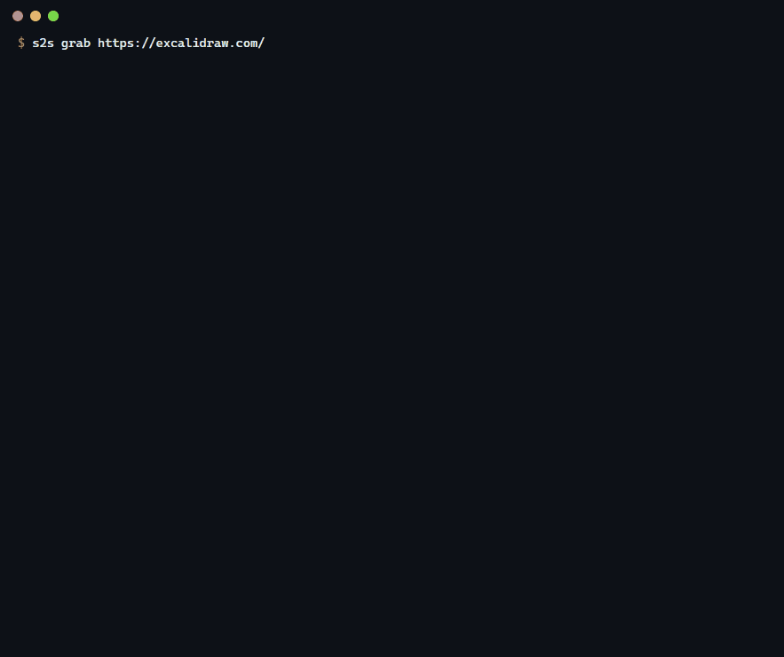
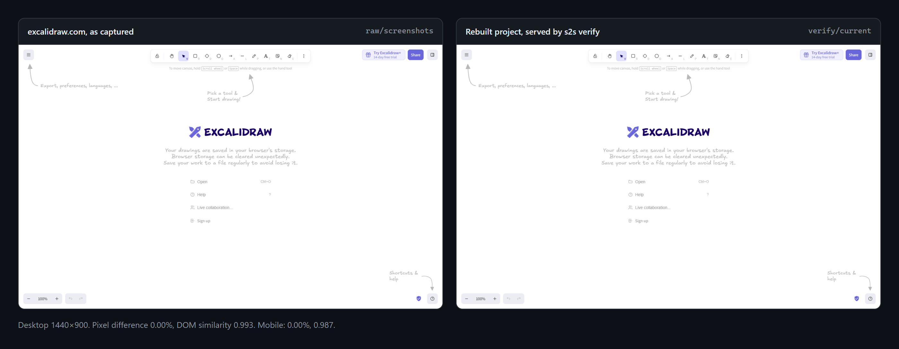
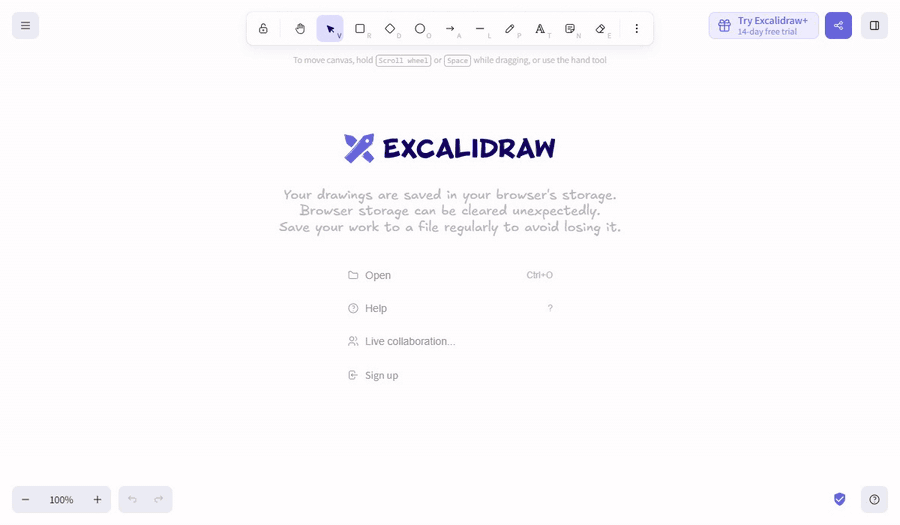
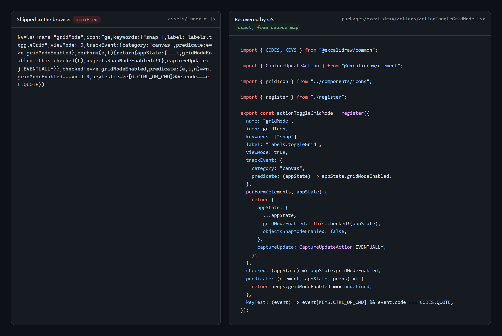

# s2s — Site-to-Source

[](https://github.com/Rosdal/s2s/actions/workflows/ci.yml)

[](LICENSE)

s2s turns a live URL into a plausible, buildable reconstruction of its frontend source. The CLI does the deterministic work: it captures the page in a real browser, recovers source maps, detects third-party packages, unbundles and cleans up the first-party code, and scaffolds a project. Then it writes `AGENTS.md` and `PROMPT.md`, so the reasoning-heavy part (naming, structure, types) runs in Claude Code on your own subscription, with a screenshot-diff verify loop to check the result.

**[Project page with the full showcase →](https://rosdal.github.io/s2s/)**



> **Status: alpha.** Every stage runs end to end on the test fixtures and on real sites like excalidraw.com. Expect rough edges.

## Showcase: excalidraw.com

One `s2s grab https://excalidraw.com/` took about four minutes: 133 source maps, 1,047 recovered source files, 107 detected packages, and a Vite project that installed and built on the first try. A Claude Code session then worked through `PROMPT.md` group by group, and `s2s verify` stayed green across all 51 commits.



The rebuilt project is the working app, not a picture of it:



What the browser received, and what s2s recovered from it:



Excalidraw is an easy target: its source maps carry the original files, so 700 first-party modules came back exactly and the renaming pass never ran. Without source maps, names and module boundaries are guesses. CSS came from the compiled stylesheet rather than the original SCSS, and verify checks each page's first-load state, not every interaction. Excalidraw is MIT-licensed; it is shown here as a reconstruction target, with no affiliation.

## Usage

s2s needs Node 22.15 or later, Google Chrome (or Playwright's Chromium: `npx playwright install chromium`), git, and a package manager (pnpm, npm, yarn or bun).

```sh
npx @rosdal/s2s grab https://example.com
```

`grab` captures the site, recovers what it can, writes a Vite project that builds as is, and checks that project against the capture. It ends by printing the next step:

```sh
cd example-com && claude "$(cat PROMPT.md)"
```

Run `s2s` with no arguments for a guided prompt instead. Each stage is also its own command, and every stage resumes from the workspace's `manifest.json`, so rerunning `grab` after an interruption continues where it stopped:

| Command             | Stage                                                                |
| ------------------- | -------------------------------------------------------------------- |
| `s2s capture <url>` | Record every request, page snapshot and screenshot in a real browser |
| `s2s maps`          | Recover original sources from source maps                            |
| `s2s detect`        | Identify npm packages and write `project/package.json`               |
| `s2s unbundle`      | Split first-party code into readable modules and agent work groups   |
| `s2s scaffold`      | Write the Vite project, the agent files and a git repo               |
| `s2s verify`        | Build the project and compare it with the capture                    |

## Package fingerprints

Sites rarely say which libraries they ship. Besides source maps, CDN URLs, banners and version strings, `s2s detect` recognizes packages by AST fingerprints of their minified functions, from an index of about 1,000 browser packages across their recent versions:

```sh
s2s db pull     # download the index (once; detect suggests it again after 30 days)
s2s db status   # what is installed
s2s db build @acme/ui@2.x   # fingerprint a private or niche package into a local overlay
```

On the benchmark (generated apps built with webpack, Vite, Rolldown and esbuild, plus a held-out terser setting the index never saw), at medium confidence and above:

<!-- bench:start -->
<!-- bench:end -->

How it works, how to request a package and how to run the benchmark: [docs/fingerprints.md](docs/fingerprints.md).

## Reconstructing with Claude Code

The CLI does the deterministic work. Naming, structure and types are left to a coding agent, run on your own subscription. The workspace holds what the agent needs:

- `AGENTS.md` (imported by `CLAUDE.md`): the rules, the detected stack and packages, each fact pointing at the `analysis/` file it came from.
- `PROMPT.md`, also available as the `/s2s` slash command: the task. It is resumable, so a new session with the same prompt continues from the first unticked item.
- `PROGRESS.md`: one checklist item per work group, plus packages to review.
- `.claude/settings.json`: pre-approves `s2s verify`, the project's build and typecheck, and git. Nothing else.

The agent moves code out of `project/src/_recovered/` one group at a time, runs `s2s verify` after each, and commits when it passes. Verify serves the build with the captured responses replayed, never contacts the real site, and fails on:

- more than 2% of pixels changed per page and viewport (regions that changed on their own during capture, such as clocks and carousels, are masked),
- DOM similarity to the captured page below 0.95,
- console errors the capture did not have, or
- failed requests.

Exit codes are 0 for pass, 1 for a regression (details in `verify/report.md`), 2 for a failed build and 3 when verify itself could not run. Thresholds live in the workspace's `s2s.config.ts`.

## three.js and WebGL

On a three.js site (vanilla or React Three Fiber), capture also records the scene. It loads each page again on a frozen clock, with seeded randomness and software rendering, and walks a set of keyframes: 0, 1 and 3 seconds at the top, then one per viewport height of scroll (`--keyframes` and `--max-keyframes` change the set). At each keyframe it saves a screenshot and a snapshot of the scene graph (hierarchy, names, transforms, cameras, lights, materials, textures), plus the final GLSL of every shader program. Two captures of the same site give the same files.

The scaffold keeps the structure and lets you choose what happens to the art with `--assets`:

| Mode              | Models, textures and sounds in `project/`                                                                                      | Verify compares                        |
| ----------------- | ------------------------------------------------------------------------------------------------------------------------------ | -------------------------------------- |
| `proxy` (default) | Generated stand-ins: boxes, spheres and cylinders with the original names, bounds and animations; flat materials; silent audio | Scene snapshots at every keyframe      |
| `clone`           | The originals simplified (`--clone-ratio`, default 0.25), textures downscaled (`--clone-texture`, default 512 px)              | Snapshots, and canvas pixels within 8% |
| `original`        | The captured files, unchanged                                                                                                  | Snapshots, and canvas pixels within 3% |

Only `proxy` leaves the site's art out of the project, and it checks that no original file ended up there. `clone` and `original` are for local study only, and every file s2s writes in those modes says so. Custom shaders come back as `.glsl` files imported with `?raw`, with three's built-in chunks folded back to `#include` lines. `ASSETS.md` lists each asset with the scene nodes and code that use it and what a replacement has to keep.

## Limits

- Next.js, Nuxt, Astro and SvelteKit sites become a Vite single-page app built from the hydrated DOM, not a project in their framework.
- WebGPU (three's `WebGPURenderer`, TSL, WGSL), Babylon.js and PlayCanvas are detected and reported, not recovered.
- Only what a visitor's browser receives can be recovered: no server code, comments, tests or history.
- Without source maps, names and module boundaries are guesses. The agent improves them; it cannot know the originals.
- Pages behind interactions the capture didn't trigger are missing, and verify blocks any request the capture has no response for.

## Intended use

s2s is an analysis and learning tool. Use it to:

- learn how a site's frontend is built,
- analyse code that already runs in your browser, and
- recover frontend source that you own but lost.

Do not use it to:

- **redistribute or reuse someone else's code.** Reconstructed first-party code still belongs to the site owner.
- **ignore a site's terms.** Many sites forbid scraping. s2s keeps polite defaults (rate limit, `robots.txt`, an honest user agent) and will never bypass logins, paywalls, CAPTCHAs or bot protection.

s2s cannot recover server code, APIs, environment variables, comments, tests or history, only what a public visitor's browser receives. Output stays on your machine; the tool has no upload or sharing features.

You are responsible for how you use it. This section is not legal advice.

## Repository layout

| Package                 | npm name                   | Visibility        |
| ----------------------- | -------------------------- | ----------------- |
| `packages/cli`          | `@rosdal/s2s`              | public, bin `s2s` |
| `packages/core`         | `@rosdal/s2s-core`         | private           |
| `packages/fingerprints` | `@rosdal/s2s-fingerprints` | private           |
| `packages/ui`           | `@rosdal/s2s-ui`           | private           |

## Contributing

See [CONTRIBUTING.md](CONTRIBUTING.md). Report security issues as described in [SECURITY.md](SECURITY.md).

## License

[MIT](LICENSE) © Rosdal
