# @rosdal/s2s

s2s (Site-to-Source) turns a live URL into a plausible, buildable reconstruction of its frontend source. It captures the page in a real browser, recovers source maps, detects third-party packages, unbundles and cleans up the first-party code, and scaffolds a Vite project. Then it writes `AGENTS.md` and `PROMPT.md`, so the reasoning-heavy part (naming, structure, types) runs in Claude Code on your own subscription, with a screenshot-diff verify loop to check the result.

> **Status: alpha.** Every stage runs end to end on the test fixtures. Expect rough edges on real sites.

## Requirements

- Node 22.15 or later
- Google Chrome, or Playwright's Chromium (`npx playwright install chromium`)
- git
- a package manager: pnpm, npm, yarn or bun

## Usage

```sh
npx @rosdal/s2s grab https://example.com
```

`grab` captures the site, recovers what it can, writes a Vite project that builds as is, and checks that project against the capture. It ends by printing the next step:

```sh
cd example-com && claude "$(cat PROMPT.md)"
```



Run `s2s` with no arguments for a guided prompt. Each stage is also its own command, and every stage resumes from the workspace's `manifest.json`, so rerunning `grab` after an interruption continues where it stopped:

| Command             | Stage                                                                |
| ------------------- | -------------------------------------------------------------------- |
| `s2s capture <url>` | Record every request, page snapshot and screenshot in a real browser |
| `s2s maps`          | Recover original sources from source maps                            |
| `s2s detect`        | Identify npm packages and write `project/package.json`               |
| `s2s unbundle`      | Split first-party code into readable modules and agent work groups   |
| `s2s scaffold`      | Write the Vite project, the agent files and a git repo               |
| `s2s verify`        | Build the project and compare it with the capture                    |

`s2s <command> --help` lists each command's options.

## Package fingerprints

`s2s detect` also recognizes packages by AST fingerprints of their minified functions, from an index of about 1,000 browser packages:

```sh
s2s db pull                 # download the index
s2s db status               # what is installed
s2s db build @acme/ui@2.x   # fingerprint a private or niche package into a local overlay
```

See [docs/fingerprints.md](https://github.com/Rosdal/s2s/blob/main/docs/fingerprints.md) for how it works.

## Verify

`s2s verify` builds the project, serves it with the captured responses replayed (it never contacts the real site), and fails on more than 2% of pixels changed per page and viewport, DOM similarity below 0.95, new console errors, or failed requests. Exit codes are 0 for pass, 1 for a regression (details in `verify/report.md`), 2 for a failed build and 3 when verify itself could not run. Thresholds live in the workspace's `s2s.config.ts`.

## Limits

- Next.js, Nuxt, Astro and SvelteKit sites become a Vite single-page app built from the hydrated DOM, not a project in their framework.
- Only what a visitor's browser receives can be recovered: no server code, comments, tests or history.
- Without source maps, names and module boundaries are guesses.
- Pages behind interactions the capture didn't trigger are missing.

## Intended use

s2s is an analysis and learning tool: for learning how a site's frontend is built, analysing code that already runs in your browser, and recovering frontend source you own but lost. Reconstructed first-party code still belongs to the site owner; do not redistribute it or use s2s against a site's terms. s2s keeps polite defaults (rate limit, `robots.txt`, an honest user agent) and never bypasses logins, paywalls, CAPTCHAs or bot protection. Output stays on your machine.

## Links

- [Source and full documentation](https://github.com/Rosdal/s2s#readme)
- [Issues](https://github.com/Rosdal/s2s/issues)
- [Changelog](https://github.com/Rosdal/s2s/blob/main/packages/cli/CHANGELOG.md)

## License

[MIT](https://github.com/Rosdal/s2s/blob/main/LICENSE) © Rosdal
